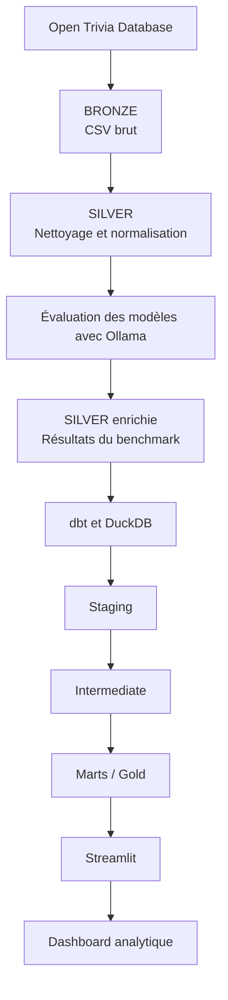

# 🎯 Trivial Pursuit — Benchmark de modèles d'IA

**Projet de Data Engineering et d'Intelligence Artificielle réalisé dans le cadre du M1 Data Engineering & Intelligence Artificielle à EFREI.**

## 📌 Présentation

Ce projet consiste à comparer les performances de modèles de langage (*Large Language Models — LLM*) exécutés localement, à partir de questions de culture générale issues d'Open Trivia Database.

Il met en œuvre un pipeline de données permettant de collecter, nettoyer, enrichir, transformer et analyser les données. Les résultats sont ensuite exploités pour comparer les modèles selon leur précision et leurs temps de réponse.

Ce travail constitue une mise en pratique de plusieurs concepts de Data Engineering : traitement de données, format Parquet, architecture Medallion, transformations SQL avec dbt, analyses avec DuckDB et visualisation avec Streamlit.

## 🎯 Objectifs du projet

* Collecter des questions de culture générale depuis Open Trivia Database.
* Nettoyer et normaliser les données avec Python et Pandas.
* Préparer les données dans un format adapté aux traitements analytiques.
* Comparer plusieurs modèles de langage exécutés localement.
* Étudier la précision des réponses et les temps d'exécution.
* Organiser les transformations selon une architecture Bronze, Silver et Gold.
* Construire des modèles analytiques avec dbt et DuckDB.
* Mettre à disposition les résultats à travers un tableau de bord interactif.

## ❓ Questions métier

Le benchmark vise notamment à répondre aux questions suivantes :

1. Quel modèle obtient la meilleure précision globale ?
2. Quel modèle répond le plus rapidement ?
3. La difficulté des questions influence-t-elle la précision ?
4. Quelles catégories présentent les meilleurs ou les moins bons résultats ?
5. Quel modèle possède les temps de réponse les plus réguliers ?

## 📊 Source et données

Les questions proviennent d'[Open Trivia Database](https://opentdb.com/).

Le projet documente un jeu de données de **5 295 questions** après nettoyage et déduplication. Ce nombre correspond à la description du projet et doit être confirmé si les données sont régénérées.

Les principales informations exploitées sont :

* Le type de question.
* La catégorie.
* Le niveau de difficulté.
* L'énoncé de la question.
* La réponse correcte.
* Les réponses incorrectes.
* Les réponses et les mesures de performance produites lors du benchmark.

## 🏗️ Architecture Data Engineering

Le projet s'appuie sur une architecture de type **Medallion**, organisée en trois couches logiques : Bronze, Silver et Gold.



### 1. Bronze — Données brutes

La couche Bronze contient les données brutes issues de la collecte.

Fichier principal :

`data/bronze/questions_raw.csv`

Cette couche constitue la source des traitements et permet de conserver les données d'origine.

### 2. Silver — Données nettoyées et enrichies

La couche Silver contient les données préparées pour les traitements analytiques.

Le script `src/processing/cleaning.py` assure notamment :

* La lecture du fichier CSV.
* Le décodage des entités HTML.
* La normalisation des espaces.
* La vérification des colonnes attendues.
* La suppression des questions vides et des doublons.
* L'export au format Parquet.

Fichier de sortie :

`data/silver/questions_clean.parquet`

Le projet contient également des fichiers de résultats associés à deux modèles :

* `data/silver/questions_enriched_gemma3_4b.parquet`
* `data/silver/questions_enriched_llama3.2_3b.parquet`

Ces fichiers servent de base aux transformations analytiques du benchmark.

### 3. Gold — Modélisation analytique

La couche analytique est organisée avec dbt. Les modèles SQL sont regroupés dans `dbt/models/`.

**Staging**

Les modèles `stg_gemma` et `stg_llama` préparent les données issues des deux modèles de langage.

**Intermediate**

Le modèle `int_model_results` rassemble les résultats dans une structure commune afin de faciliter les comparaisons.

**Marts**

Les modèles analytiques répondent aux questions métier :

| Modèle                     | Rôle                                   |
| -------------------------- | -------------------------------------- |
| `mart_model_comparison`    | Comparaison globale des modèles        |
| `mart_accuracy_category`   | Analyse de la précision par catégorie  |
| `mart_accuracy_difficulty` | Analyse de la précision par difficulté |
| `mart_response_time`       | Analyse des temps de réponse           |

La matérialisation effective des modèles et la disponibilité de la base analytique dépendent de la configuration dbt et de l'exécution du pipeline.

## 🤖 Modèles de langage évalués

Les modèles sont exécutés localement à l'aide d'[Ollama](https://ollama.com/).

* **Gemma 3 4B**
* **Llama 3.2 3B**

Le benchmark permet d'étudier les réponses générées par ces modèles ainsi que les mesures de performance enregistrées.

## 📈 Métriques d'évaluation

| Métrique           | Interprétation                       |
| ------------------ | ------------------------------------ |
| Accuracy           | Proportion de réponses correctes     |
| Temps moyen        | Durée moyenne de réponse             |
| Médiane            | Valeur centrale des temps de réponse |
| Minimum et maximum | Bornes des temps observés            |
| Écart-type         | Dispersion des temps de réponse      |

L'analyse conjointe de ces indicateurs permet d'étudier le compromis entre précision, rapidité et régularité. Les résultats numériques ne sont pas présentés ici, car ils doivent être extraits des données et des modèles analytiques effectivement produits.

## 🛠️ Technologies utilisées

| Technologie   | Utilisation                              |
| ------------- | ---------------------------------------- |
| Python        | Traitement et automatisation             |
| Pandas        | Manipulation et nettoyage des données    |
| PyArrow       | Lecture et écriture des fichiers Parquet |
| Ollama        | Exécution locale des modèles de langage  |
| dbt           | Transformation et modélisation SQL       |
| DuckDB        | Analyses et stockage analytique          |
| Streamlit     | Application de visualisation             |
| Plotly        | Graphiques interactifs                   |
| Git et GitHub | Versionnement et collaboration           |

## 📁 Structure du projet

```text
trivial-pursuit-portfolio/
├── data/
│   ├── bronze/
│   │   └── questions_raw.csv
│   └── silver/
│       ├── questions_clean.parquet
│       ├── questions_enriched_gemma3_4b.parquet
│       └── questions_enriched_llama3.2_3b.parquet
├── dbt/
│   └── models/
│       ├── staging/
│       ├── intermediate/
│       └── marts/
├── notebooks/
├── src/
│   ├── ai/
│   ├── ingestion/
│   └── processing/
├── streamlit/
│   └── app.py
├── .gitignore
├── dbt_project.yml
├── requirements.txt
└── README.md
```

Cette arborescence présente les principaux éléments du projet ; le contenu exact des sous-dossiers dépend de la version publiée.

## ⚙️ Installation

### Prérequis

Installer les outils nécessaires :

* Python compatible avec les dépendances du projet.
* Git.
* Ollama, si l'on souhaite exécuter les modèles localement.

### 1. Cloner le dépôt

```powershell
git clone https://github.com/allanbrows/trivial-pursuit-portfolio.git
cd trivial-pursuit-portfolio
```

### 2. Créer un environnement virtuel

Sous Windows PowerShell :

```powershell
python -m venv .venv
.\.venv\Scripts\Activate.ps1
```

### 3. Installer les dépendances

```powershell
python -m pip install --upgrade pip
python -m pip install -r requirements.txt
```

### 4. Préparer les modèles Ollama

Après avoir installé Ollama :

```powershell
ollama pull gemma3:4b
ollama pull llama3.2:3b
ollama list
```

Ces commandes téléchargent les modèles nécessaires à leur exécution locale.

## ▶️ Exécution du projet

### Nettoyer les données

Depuis la racine du projet :

```powershell
python src/processing/cleaning.py
```

Cette commande lit les données Bronze et produit le fichier Parquet nettoyé dans Silver, si les dépendances sont installées et le fichier source disponible.

### Exécuter les transformations dbt

Le projet doit disposer d'un profil dbt valide et d'un environnement DuckDB correctement configuré avant de lancer :

```powershell
dbt debug
dbt run
```

Le profil, le chemin de la base et les données nécessaires doivent correspondre à la configuration réelle du projet.

### Lancer le tableau de bord

Lorsque la base analytique et les modèles attendus sont disponibles :

```powershell
streamlit run streamlit/app.py
```

Le tableau de bord est destiné à présenter les résultats du benchmark. Son fonctionnement dépend de la disponibilité des tables analytiques attendues par l'application.

## 🚀 Perspectives d'amélioration

Plusieurs évolutions peuvent être envisagées :

* Ajouter des tests automatisés pour le nettoyage des données.
* Améliorer la validation des données avant leur chargement dans Silver.
* Étendre le benchmark à d'autres modèles de langage.
* Comparer différentes stratégies de prompts.
* Analyser les performances selon des sous-groupes de questions.
* Renforcer la gestion des erreurs et la traçabilité des traitements.
* Automatiser l'exécution du pipeline.
* Ajouter des tests de qualité aux modèles dbt.

## 👥 Auteurs et collaboration

Projet collaboratif réalisé dans le cadre du **M1 Data Engineering & Intelligence Artificielle à EFREI**.

* **Allan Miguel Domguia** — contribution au projet et développement de son portfolio technique.
* **Soufiane Lemsouri** — auteur du projet initial et collaborateur.

Les rôles précis sont à ajuster selon les contributions réellement réalisées par chacun.

**Dépôt GitHub :** [allanbrows/trivial-pursuit-portfolio](https://github.com/allanbrows/trivial-pursuit-portfolio)

---

Ce dépôt présente le projet et les compétences mobilisées en Data Engineering, traitement de données et analyse des performances de modèles d'IA.
